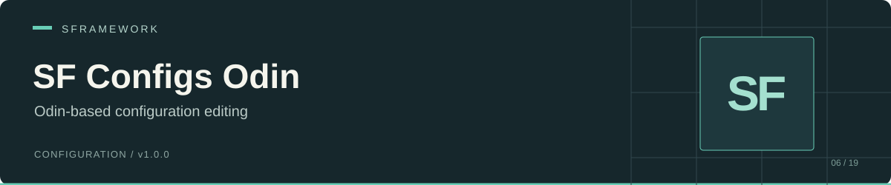

# SF Configs Odin

[Documentation website](https://docs.secretplace.studio/#sf-configs-odin)

An Odin Inspector editor window for JSON configurations from [SF Configs](https://github.com/huran438/sf-configs). Browse configuration instances, edit their values, and write them back to their source files. Node configurations also offer **Save As** and **New** actions.

Package: `sp.sframework.configs.odin` · Version: `1.0.0` · Editor only · [MIT license](LICENSE.md)

[Install](#install) · [Setup](#setup) · [Editing and saving](#editing-and-saving) · [API](#api) · [Limits](#limits-and-troubleshooting)

## Install

In Unity's Package Manager, choose **Add package from git URL** and enter:

```text
https://github.com/huran438/sf-configs-odin.git#main
```

Install the dependencies before opening the window:

| Requirement | Assembly references |
| --- | --- |
| [SF Core](https://github.com/huran438/sf-core) | `SFramework.Core.Runtime`, `SFramework.Core.Editor` |
| [SF Configs](https://github.com/huran438/sf-configs) | `SFramework.Configs.Runtime`, `SFramework.Configs.Editor` |
| Odin Inspector | `Sirenix.OdinInspector.Editor.dll`, `Sirenix.OdinInspector.Attributes.dll`, `Sirenix.Utilities.dll`, `Sirenix.Utilities.Editor.dll`, `Sirenix.Serialization.dll`, `Sirenix.Serialization.Config.dll` |
| Newtonsoft.Json | `Newtonsoft.Json.dll` |

The package manifest does not declare dependencies. Odin Inspector is an external dependency; this repository does not bundle or install it. SF Core and SF Configs also require their own dependencies, including UniTask.

The editor assembly has an `ODIN_INSPECTOR` define constraint. Confirm that the symbol exists in the project's compilation settings after installing Odin. Defining the symbol alone does not provide the referenced DLLs.

The manifest specifies no Unity version. This README reflects static source inspection; the window and its examples have not been run in Unity.

## Setup

1. Define a concrete `SFGlobalConfig` or `SFNodesConfig` class in your runtime scripts.
2. Set `ConfigsPaths` in `Assets/SFramework/Settings/SFConfigsSettings.json`.
3. Choose **Tools > SFramework > Refresh Configs** to refresh the shared configuration cache.
4. Open **Window > SFramework > Configs**.

For a minimal global configuration, create `GameGlobalConfig.cs`:

```csharp
using System;
using SFramework.Configs.Runtime;

[Serializable]
public sealed class GameGlobalConfig : SFGlobalConfig
{
    public int StartingCoins = 50;
}
```

Use this settings file:

```json
{
  "ConfigsPaths": ["Assets/Resources/Configs"]
}
```

Create `Assets/Resources/Configs/GameGlobalConfig.json`:

```json
{
  "Type": "GameGlobalConfig",
  "Version": 0,
  "StartingCoins": 50
}
```

SF Core creates an empty settings file during the first settings lookup when none exists. Fill in the paths and refresh again. SF Configs refresh can also create a default JSON file for each concrete configuration class without a matching file, using a parameterless constructor.

Use folders under `Assets` for editor discovery. If the runtime `SFConfigsService` must load the same JSON, place the files under a `Resources` folder. The runtime loader ignores `ConfigsPaths` and scans Resources instead.

## Editing and saving

The window groups `ISFNodesConfig` instances under **Node Configs**, using their root `Id` for the final menu segment. It groups other `ISFConfig` instances under **Global Configs**. It derives display labels from `Type`, removes selected naming fragments such as `SF` and `Config`, inserts spaces, and sorts menu items by name.

Select a configuration and edit it in the Odin panel. The title displays `Version` as a date calculated from Unix seconds.

| Action | Result |
| --- | --- |
| **Save** | Sets `Version` to the current UTC Unix timestamp, writes indented JSON to the cached source path, refreshes assets, and reloads the window |
| **Save As** | For node configurations, writes the edited instance to a file selected in a save dialog, with a new timestamp |
| **New** | For node configurations, creates a fresh instance of the selected type, sets `Type` and an initial `Id`, and writes it to the selected file |
| **Reload** | Refreshes SF Configs' shared cache and rebuilds the menu tree |

Edits stay in the cached object until you save. Reload reads configurations again from disk; save before reloading to keep your changes. Save As copies the edited instance rather than creating a blank configuration. New calls the configuration type's parameterless constructor.

For the example, select the global configuration, change `StartingCoins`, and click **Save**. Inspect the resulting JSON before consuming it at runtime: SF Configs requires the exact class name in `Type`, placed first or last in the object.

## API

| API | Role |
| --- | --- |
| `SFramework.Configs.Odin.Editor.SFConfigsWindow` | `OdinMenuEditorWindow` implementation |
| `SFConfigsWindow.OpenWindow()` | Refreshes configurations and opens the window; focuses an existing window when one is already open |
| `SFConfigsEditorUtility.RefreshConfigs()` | Shared discovery, default-file creation, and editor-cache refresh in SF Configs |
| `SFConfigsEditorUtility.FindConfigsWithPaths(Type)` | Supplies the window with cached instances and source paths |

To open the window from your own editor menu, place this file in an `Editor` folder. Your editor assembly must reference `SFramework.Configs.Odin.Editor` and use the same `ODIN_INSPECTOR` constraint:

```csharp
#if UNITY_EDITOR && ODIN_INSPECTOR
using SFramework.Configs.Odin.Editor;
using UnityEditor;

public static class OpenGameConfigs
{
    [MenuItem("Tools/Game/Configs")]
    public static void Open()
    {
        SFConfigsWindow.OpenWindow();
    }
}
#endif
```

## Limits and troubleshooting

- If the menu item is missing, check `ODIN_INSPECTOR`, the Odin DLLs, and the assembly dependencies. This package contains no runtime assembly.
- An empty menu usually means missing search paths or unmatched `Type` values. The window uses the SF Configs cache; **Reload** also triggers that package's default-file creation behavior.
- Keep configuration files under `Assets`. Save builds an absolute path from `Application.dataPath` and the cached asset path. A Save As file outside the configured folders will not appear on reload; a file outside Resources will not load through `SFConfigsService`.
- New derives its initial `Id` from the computed source path, rather than from the file you choose in the dialog. Check and edit the `Id` after creating the file. New leaves `Version` at the constructor's default until a later Save.
- Avoid duplicate global configurations of the same type and node configurations with the same type and root `Id`; they map to the same menu labels.
- The window writes JSON files with Newtonsoft.Json and refreshes Unity's asset database. It has no conflict detection, migration, runtime reload, or undo-backed file persistence.

## Source and related packages

- [Window implementation](Editor/SFConfigsWindow.cs)
- [Editor assembly and DLL requirements](Editor/SFramework.Configs.Odin.Editor.asmdef)
- [Package manifest](package.json)
- [SF Configs](https://github.com/huran438/sf-configs) for configuration contracts and runtime loading; [SF Core](https://github.com/huran438/sf-core) for settings and service infrastructure

Source snapshot: [`42aaf98cbb50f322bcfc7d0d32c7e07d91208355`](https://github.com/huran438/sf-configs-odin/commit/42aaf98cbb50f322bcfc7d0d32c7e07d91208355) (`main`). Example validation: static API review only; no compilation or execution in Unity.
