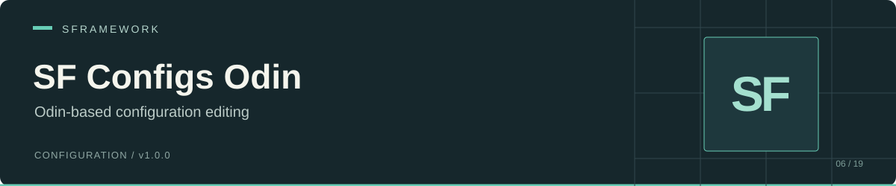

# SF Configs Odin

 

## Overview

SF Configs Odin provides an Odin Inspector editor window for JSON configurations from SF Configs. Browse cached instances, edit values, and save them to their source files. Node configurations also offer **Save As** and **New** actions. This package is Editor-only.

## Requirements

- `SFramework.Configs.Odin.Editor` references `SFramework.Core.Runtime`, `SFramework.Core.Editor`, `SFramework.Configs.Runtime`, and `SFramework.Configs.Editor`. Install [SF Core](https://github.com/huran438/sf-core), [SF Configs](https://github.com/huran438/sf-configs), and their dependencies, including UniTask.
- Required precompiled DLLs are `Sirenix.OdinInspector.Editor.dll`, `Sirenix.OdinInspector.Attributes.dll`, `Sirenix.Utilities.dll`, `Sirenix.Utilities.Editor.dll`, `Sirenix.Serialization.dll`, `Sirenix.Serialization.Config.dll`, and `Newtonsoft.Json.dll`.
- The assembly has an `ODIN_INSPECTOR` define constraint. Install Odin Inspector and confirm the symbol exists; defining it alone does not supply the DLLs.
- See [package.json](package.json) for package dependencies and the minimum Unity version. Install the Odin DLLs separately.

## Installation

In Unity Package Manager, choose **Add package from git URL**:

```text
https://github.com/huran438/sf-configs-odin.git#main
```

Or add this entry to `dependencies` in the host project's `Packages/manifest.json`:

```json
"sp.sframework.configs.odin": "https://github.com/huran438/sf-configs-odin.git#main"
```

Use a commit hash instead of `main` to pin a revision.

## Quick start

Create `GameGlobalConfig.cs` in runtime scripts:

```csharp
using System;
using SFramework.Configs.Runtime;

[Serializable]
public sealed class GameGlobalConfig : SFGlobalConfig
{
    public int StartingCoins = 50;
}
```

Create `Assets/SFramework/Settings/SFConfigsSettings.json`:

```json
{
  "ConfigsPaths": ["Assets/Resources/Configs"]
}
```

Create `Assets/Resources/Configs/GameGlobalConfig.json`:

```json
{
  "Type": "GameGlobalConfig",
  "Version": 0,
  "StartingCoins": 50
}
```

Choose **Tools > SFramework > Refresh Configs**, then **Window > SFramework > Configs**. Select the global configuration, edit `StartingCoins`, and click **Save**. Set `Type` to the exact class name for SF Configs runtime loading.

Manual JSON creation is optional: opening the window refreshes SF Configs, which creates missing settings, folders, and one default JSON for each configuration type without an existing file. Empty search paths default to `Assets/Resources/Configs`. Existing configurations are preserved.

## API

| API or action | Purpose |
| --- | --- |
| `SFramework.Configs.Odin.Editor.SFConfigsWindow` | Odin menu editor window. |
| `SFConfigsWindow.OpenWindow()` | Focus an existing window, or refresh configurations and open a new one. |
| **Save** | Set `Version` to the current UTC Unix timestamp and replace the source JSON file, then refresh assets and reload. |
| **Save As** | Copy edited node data into a new JSON file with an updated timestamp and a root `Id` taken from the selected filename. |
| **New** | Construct a fresh node config, set `Type` to its class name, and take its root `Id` from the selected filename. |
| **Reload** | Refresh the shared SF Configs cache and rebuild the menu. |
| `SFConfigsEditorUtility.RefreshConfigs()` | Shared SF Configs discovery and default-file creation. |
| `SFConfigsEditorUtility.FindConfigsWithPaths(Type)` | Read cached instances and source asset paths. |

The menu groups node configurations by type and root `Id`, and global configurations by type. Labels remove naming fragments such as `SF` and `Config`, add spaces, and sort alphabetically. `Version` is displayed as a date derived from Unix seconds.

Custom editor code opening the window must reference `SFramework.Configs.Odin.Editor` and use the same `ODIN_INSPECTOR` constraint.

## Behavior and limitations

- A missing menu item usually indicates missing `ODIN_INSPECTOR`, Odin DLLs, or assembly dependencies. There is no runtime assembly in this package.
- Edits affect cached objects until saved. Reload reads from disk and discards unsaved edits. New calls the parameterless constructor and keeps its default version until the first Save.
- All three actions require a JSON path under the project's `Assets` folder. Put files in the configured search folders to see them on reload. Place runtime configs in a Resources folder so `SFConfigsService` can load them.
- Save As and New require an unused file path. A node config's root ID must be unique among saved configurations of the same type. Save checks the edited root ID and ignores the file being replaced.
- Avoid duplicate global configs of one type because they share a menu label. An empty menu can indicate missing paths or mismatched `Type` values.
- Writes stage the complete JSON beside the destination before moving it into place. Reload also runs SF Configs' default-file creation.

## Tests

Package tests are in [Tests/Editor](Tests/Editor), in assembly `SFramework.Configs.Odin.Editor.Tests`. Install Unity Test Framework and add this package ID to the **top-level** `testables` array in the host project's `Packages/manifest.json`, preserving existing entries:

```json
"testables": ["sp.sframework.configs.odin"]
```

Open **Window > General > Test Runner**, choose **EditMode**, and run the package tests. The local `sf-demo` host enables all SFramework package tests. This integration test assembly requires both `UNITY_INCLUDE_TESTS` and `ODIN_INSPECTOR`, with the Odin DLLs and other requirements installed; it is excluded when Odin is unavailable.

## License

MIT. See [LICENSE.md](LICENSE.md).
